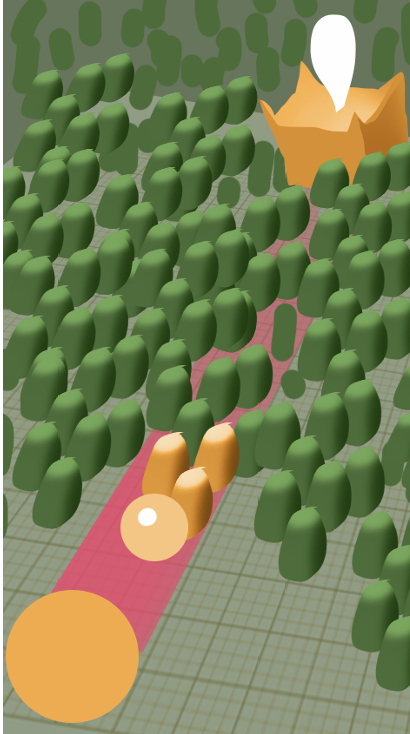

# SelfBulletting

Прототип гіпер-кежуал гри (тестове завдання). Куля-гравець стріляє частиною себе: кожен постріл зменшує кулю і підриває перешкоди, що заважають їй докотитися до дверей.



Повне ТЗ з усіма правилами й рішеннями — [docs/SPEC.md](docs/SPEC.md).

## Як запустити

- **Unity 6000.6.5**, URP, платформа Android (портрет).
- Відкрити проєкт і натиснути **Play** у будь-якій сцені: Play Mode завжди стартує з `Boot` (`Editor/BootSceneOnPlay`).
- Game View краще перемкнути на портретну роздільність, наприклад 1080×1920.
- **APK:** Build Profiles → Android → Build, результат — у папку `Builds/` поруч з `Assets` (вона в `.gitignore`, тому APK у репозиторії немає).

## Як грати

1. Затисни палець: від кулі відділяється постріл, а шкала ходить від мінімуму до максимуму за 3 с і назад.
2. Відпусти: постріл летить у першу перешкоду на шляху і заражає всі перешкоди в радіусі ураження, вони вибухають хвилею.
3. Що довше тримаєш (що вище шкала), то сильніший постріл і то більше кулі він забирає.
4. Щойно шлях завширшки з кулю вільний до фінішу, куля стрибками котиться до дверей — перемога.
5. Якщо куля стала мінімальною, а шлях закритий, — поразка.

Угорі екрана — залишок кулі (смуга і відсоток), він оновлюється, коли постріл повністю відпрацював.

За кожну перешкоду — очки, за 3+ перешкоди одним пострілом — множник комбо (і що більше комбо, то яскравіший звук). На фініші — бонус за кожен відсоток кулі, що лишився понад мінімум, тож розчищати шлях вигідно економно. Загальний рахунок зберігається між запусками й видно в меню.

## Як ми трактували ТЗ

| У ТЗ | Як зроблено |
|---|---|
| Куля зменшується пропорційно пострілу | Лінійно через радіус, у відсотках від стартового радіуса R₀ |
| Мінімальний критичний розмір | Дорівнює ціні мінімального пострілу (`MinShootPercent`, 10%); менше куля не буває |
| Розмір пострілу залежить від часу утримання | Шкала пінг-понг 0 → 1 → 0 за 3 + 3 с; від її значення залежать ціна пострілу (10–40%) і радіус ураження. Сама куля-постріл завжди одного розміру |
| Перекачав кулю в постріл | Шкала обрізається під залишок кулі: дорожче, ніж вистачає, вистрілити не можна. Відпустив на верхній межі — це останній постріл |
| Постріл летить у напрямку цілі й заражає першу перешкоду | Постріл летить у першу перешкоду, що перекриває коридор кулі (SphereCast з радіусом кулі), — так жоден постріл не пролітає повз |
| Зараження в радіусі дії | Вибухають усі перешкоди в радіусі ураження, по черзі від найближчої до точки влучання |
| Куля просувається по розчищеній доріжці | Куля стоїть на старті й рушає лише тоді, коли весь шлях до фінішу вільний |
| Двері відкриваються за 5 м | Так, `FinishSettings.DoorOpenDistance` |
| Запас 20% | Робиться левел-дизайном: генератор + ручне доведення рівня |

Деталі й крайні випадки — розділи 4–5 у [docs/SPEC.md](docs/SPEC.md).

## Архітектура

```
Boot (завантажена весь час)
└─ Bootstrap — створює сервіси й стейт-машину вручну, без DI-фреймворку
   └─ AppStateMachine: Loading → Menu → Game → Final ─┬─ Menu
                                                     └─ Game (Retry, рівень з нуля)
Menu  (адитивно)  MenuEntryPoint
Game  (адитивно)  GameEntryPoint → GameLoop: перевірка шляху → приціл → постріл → вибухи → знову
```

- **Ручне впровадження залежностей.** Сервіси створює `Bootstrap`, стани отримують їх через конструктор, сцени — через `EntryPoint.Construct(...)`. Ні статики, ні сервіс-локатора.
- **Сцени Menu і Game** вантажаться адитивно і повністю вивантажуються. Кожен вхід у гру і кожен Retry починаються з нуля, тож стан рівня не тягнеться між раундами.
- **Стейт-машина** виконує переходи по одному; подвійний тап по кнопці не запустить завантаження двічі.
- **Логіка окремо від показу.** Правила, економіка пострілу, шкала, очки — чисті C#-класи з тестами. Геймплей говорить з відображенням лише через інтерфейси з `Gameplay/Presentation` (`IBallView`, `IShotView`, `IPathView`, `IAimView`, `IScoreView`, `IDoorView`, `IObstacleView`, `IBallHealthView`); відсутню в'юшку замінює Null-реалізація.
- **Асинхронність** — UniTask, анімації — DOTween з `SetLink` і токенами скасування.
- **Фізика** — `SphereCastNonAlloc` / `OverlapSphereNonAlloc` з наперед виділеними буферами.
- **Звук** іде через `IAudioService` (`SoundId` → кліп із `SoundLibrary`); кліпи синтезовані скриптом `Audio/Source~/generate_sounds.py`. Без бібліотеки підставляється `NullAudioService`. **Вібрація** — `VibrationEffect` через JNI на Android.

### Структура

```
Assets/Project/
  Configs/SettingsConfig.asset     усі налаштування гри
  Scenes/                          Boot, Menu, Game
  Scripts/Infrastructure/          Bootstrap, стейт-машина, стани, сервіси
  Scripts/Gameplay/                логіка раунду і контракти відображення
  Scripts/Views/                   реалізації відображення
  Scripts/UI/                      шторка, меню, фінальний екран
  Editor/                          старт Play Mode з Boot, генератор рівня
  Tests/EditMode/                  тести
```

## Налаштування

Усі числа — в `Assets/Project/Configs/SettingsConfig.asset`, розділи `Ball`, `Aim`, `Shot`, `Infection`, `Score`, `Feedback`, `Finish`, `Loading`, `Physics`, `Application`. Таблиця з дефолтами — розділ 11 у [docs/SPEC.md](docs/SPEC.md).

## Рівень і генератор

Меню **SelfBulletting → Level → Generate Obstacles** заповнює рівень у сцені Game перешкодами: сітка з випадковим зсувом, чисті зони біля старту й фінішу, той самий seed — той самий рівень, Undo підтримується. Налаштування — **SelfBulletting → Level → Select Generation Settings**.

## Тести

Window → General → Test Runner → EditMode → Run All. Покрито: стейт-машину, економіку пострілу, шкалу, правила раунду, очки й комбо, попередження про небезпеку, фінальну послідовність, фізичні запити і генератор рівня.

## Стиль коду

Microsoft C# Coding Conventions + Clean Code, правила — в `.editorconfig`.

## Сторонні пакети

- [UniTask](https://github.com/Cysharp/UniTask) 2.5.11 — з OpenUPM.
- [DOTween](http://dotween.demigiant.com/) — з Asset Store, у `Assets/Plugins/Demigiant`.

## Поза обсягом

Один рівень, без прогресії, магазину, реклами й аналітики.
