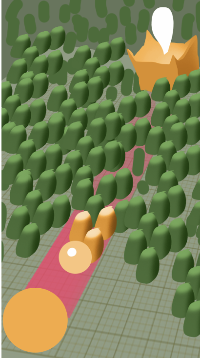

# SelfBulletting

Прототип гіпер-кежуал гри (тестове завдання). Куля-гравець стріляє частиною себе: кожен постріл зменшує кулю і підриває перешкоди, що заважають їй докотитися до дверей. Візуально це крапля води, яка гасить вогнища: постріл — менша крапля, що розбризкується при влучанні, а «вибух» перешкоди — вогонь, що згасає з хмаркою пари.



У меню три режими: **Classic** (пряма доріжка, постріл котиться по ній) і два режими прицілу — **Slingshot** та **Arrow**, де доріжка до дверей крива, а постріл летить дугою в точку, яку обирає гравець.

Повне ТЗ з усіма правилами й рішеннями — [docs/SPEC.md](docs/SPEC.md).

## Як запустити

- **Unity 6000.6.5**, URP, платформа Android (портрет).
- Відкрити проєкт і натиснути **Play** у будь-якій сцені: Play Mode завжди стартує з `Boot` (`Editor/BootSceneOnPlay`).
- Game View краще перемкнути на портретну роздільність, наприклад 1080×1920.
- **APK:** Build Profiles → Android → Build, результат — у папку `Builds/` поруч з `Assets` (вона в `.gitignore`, тому APK у репозиторії немає).

## Як грати

У меню обери режим. На кнопці кожного режиму — його поточний рівень і загальний рахунок: прогрес у режимів окремий.

### Classic

1. Затисни палець: від кулі відділяється постріл, а шкала ходить від мінімуму до максимуму за 3 с і назад.
2. Відпусти: постріл летить у першу перешкоду на шляху і заражає всі перешкоди в радіусі ураження, вони вибухають хвилею.
3. Що довше тримаєш (що вище шкала), то сильніший постріл і то більше кулі він забирає.
4. Щойно шлях завширшки з кулю вільний до фінішу, куля стрибками котиться до дверей — перемога.
5. Якщо куля стала мінімальною, а шлях закритий, — поразка.
6. Після перемоги кнопка **NEXT** веде на наступний рівень, після поразки **RETRY** повторює той самий, обидві — у тому самому режимі. Classic завжди грає один рівень, `Level_01`.

### Slingshot і Arrow (режими прицілу)

Доріжка до дверей — плавна крива, тож розчищати її треба в кількох місцях. Постріл летить дугою над вогнищами й гасить усе в радіусі ураження навколо точки падіння. Промах можливий: якщо там немає вогнищ, маса все одно витрачена.

- **Slingshot:** постав палець будь-де і тягни назад — постріл полетить у протилежний бік, а довжина тягу задає дальність. Сила — та сама шкала, що в Classic (пінг-понг, поки тримаєш). Відпустив — постріл. Відпустив майже без тягу — скасування, нічого не витрачено.
- **Arrow (два тапи):** стрілка біля кулі сама хитається від «вгору» до «праворуч» — тап фіксує напрямок. Потім точка падіння сама ходить уздовж стрілки — другий тап стріляє туди. Що далі точка, то менший постріл: поруч — найбільший, який може дозволити куля, на краю — мінімальний.
- Під час прицілювання видно пунктирну дугу, кільце ураження і підсвічені вогнища, які згаснуть.
- Останній постріл без шкали теж прицілюється, напис підказує «aim and fire».

Угорі екрана — залишок кулі (смуга і відсоток), він оновлюється, коли постріл повністю відпрацював.

За кожну перешкоду — очки, за 3+ перешкоди одним пострілом — множник комбо (і що більше комбо, то яскравіший звук). На фініші — бонус за кожен відсоток кулі, що лишився понад мінімум, тож розчищати шлях вигідно економно. Загальний рахунок зберігається між запусками й видно в меню.

## Як ми трактували ТЗ

| У ТЗ | Як зроблено |
|---|---|
| Куля зменшується пропорційно пострілу | Лінійно через радіус, у відсотках від стартового радіуса R₀ |
| Мінімальний критичний розмір | Дорівнює ціні мінімального пострілу (`MinShootPercent`, 10%); менше куля не буває |
| Розмір пострілу залежить від часу утримання | Шкала пінг-понг 0 → 1 → 0 за 3 + 3 с; від її значення залежать ціна пострілу (10–40%) і радіус ураження. Куля-постріл стартує з власного розміру (`ShotStartRadiusPercent`) і росте рівно настільки, наскільки зменшується куля-гравець, а точка дотику й кільце ураження перераховуються щокадру |
| Перекачав кулю в постріл | Шкала обрізається під залишок кулі: дорожче, ніж вистачає, вистрілити не можна. Відпустив на верхній межі — це останній постріл |
| Постріл летить у напрямку цілі й заражає першу перешкоду | Постріл котиться по осі доріжки й влучає в першу перешкоду, якої справді торкнеться при поточному розмірі: під час прицілювання ціль змінюється разом із розміром пострілу. Якщо на осі нічого немає, він котиться до перешкоди, що перекриває коридор кулі, — так жоден постріл не пролітає повз |
| Зараження в радіусі дії | Вибухають усі перешкоди в радіусі ураження, по черзі від найближчої до точки влучання |
| Куля просувається по розчищеній доріжці | Куля стоїть на старті й рушає лише тоді, коли весь шлях до фінішу вільний |
| Двері відкриваються за 5 м | Так, `FinishSettings.DoorOpenDistance` |
| Запас 20% | Робиться левел-дизайном: генератор + ручне доведення рівня |
| (понад ТЗ) Режими прицілу | Slingshot і Arrow: крива доріжка через опорні точки рівня, постріл дугою в обрану точку, окремий прогрес і рахунок для кожного режиму (розділ 4.6 SPEC) |

Деталі й крайні випадки — розділи 4–5 у [docs/SPEC.md](docs/SPEC.md).

## Архітектура

```
Boot (завантажена весь час)
└─ Bootstrap — створює сервіси й стейт-машину вручну, без DI-фреймворку
   └─ AppStateMachine: Loading → Menu → Game → Final ─┬─ Menu
                                                     └─ Game (Next / Retry, рівень з нуля)
Menu  (адитивно)  MenuEntryPoint — кнопка на кожен режим
Game  (адитивно)  GameEntryPoint(рівень, режим) → GameLoop: перевірка шляху → приціл → постріл → вибухи → знову
```

- **Ручне впровадження залежностей.** Сервіси створює `Bootstrap`, стани отримують їх через конструктор, сцени — через `EntryPoint.Construct(...)`. Ні статики, ні сервіс-локатора.
- **Сцени Menu і Game** вантажаться адитивно і повністю вивантажуються. Кожен вхід у гру, Next і Retry починаються з нуля, тож стан рівня не тягнеться між раундами. Префаб поточного рівня створюється в сцені Game під час входу.
- **Стейт-машина** виконує переходи по одному; подвійний тап по кнопці не запустить завантаження двічі.
- **Логіка окремо від показу.** Правила, економіка пострілу, шкала, сплайн доріжки, рогатка, стрілка, дуга, очки — чисті C#-класи з тестами. Геймплей говорить з відображенням лише через інтерфейси з `Gameplay/Presentation` (`IBallView`, `IShotView`, `IPathView`, `IAimView`, `ILobAimView`, `IScreenToGround`, `IScoreView`, `IDoorView`, `IObstacleView`, `IBallHealthView`, `ILevelView`); відсутню в'юшку замінює Null-реалізація.
- **Режими.** `GameLoop` режиму не знає: `GameEntryPoint` дає йому доріжку (`GroundPath`: пряма в Classic, сплайн у режимах прицілу) і приціл (`IShotAiming`: `ClassicAimController`, `SlingshotAimController` або `ArrowAimController`).
- **Асинхронність** — UniTask, анімації — DOTween з `SetLink` і токенами скасування.
- **Фізика** — `SphereCastNonAlloc` / `OverlapSphereNonAlloc` з наперед виділеними буферами.
- **Візуал «вода гасить вогонь»** живе тільки в `Scripts/Views/`, матеріалах і шейдерах, геймплей його не знає. Вогнища — один спільний матеріал на шейдері `Fire` (процедурне полум'я на кваді, що дивиться в камеру, SRP Batcher/instancing, без частинок на перешкоду), стан згасання йде через `MaterialPropertyBlock`. Крапля і постріл — шейдер `WaterDrop` на сфері: нижня половина лишається сферою радіуса кулі, тож розміри збігаються з фізикою. Пара від згаслих вогнищ — одна система частинок на сцену, а звук `Explode` — шипіння. При влучанні вода розбризкується й розтікається калюжами разом із хвилею зараження (`WaterSplashEffect`), а `ShotFire` звучить як сплеск. Деталі — розділ 12 у [docs/SPEC.md](docs/SPEC.md).
- **Звук** іде через `IAudioService` (`SoundId` → кліп із `SoundLibrary`); кліпи синтезовані скриптом `Audio/Source~/generate_sounds.py`. Без бібліотеки підставляється `NullAudioService`. **Вібрація** — `VibrationEffect` через JNI на Android.

### Структура

```
Assets/Project/
  Configs/SettingsConfig.asset     усі налаштування гри
  Configs/LevelCatalog.asset       рівні Classic
  Configs/CurvedLevelCatalog.asset криві рівні Slingshot і Arrow
  Levels/                          префаби рівнів
  Prefabs/                         вогнище-перешкода, «+10»
  Materials/, Shaders/, Meshes/    вогонь (Fire), крапля (WaterDrop), пара
  Textures/                        шум полум'я і пара; Source~/ — скрипт генерації
  Scenes/                          Boot, Menu, Game
  Scripts/Infrastructure/          Bootstrap, стейт-машина, стани, сервіси
  Scripts/Gameplay/                логіка раунду і контракти відображення
  Scripts/Views/                   реалізації відображення
  Scripts/UI/                      шторка, меню, фінальний екран
  Editor/                          старт Play Mode з Boot, генератор рівня і кривої
  Tests/EditMode/                  тести
```

## Налаштування

Усі числа — в `Assets/Project/Configs/SettingsConfig.asset`, розділи `Ball`, `Aim`, `Shot`, `Lob` (дальність і висота дуги), `Slingshot` (мертва зона й повний тяг), `Arrow` (сектор і швидкість стрілки, швидкість точки падіння), `Infection`, `Score`, `Feedback`, `Finish`, `Loading`, `Physics`, `Application`. Таблиця з дефолтами й поточними значеннями — розділ 11 у [docs/SPEC.md](docs/SPEC.md).

## Рівні і генератор

- Рівень — префаб у `Assets/Project/Levels/`. Classic грає `Configs/LevelCatalog.asset` (зараз тільки `Level_01`), Slingshot і Arrow — спільний `Configs/CurvedLevelCatalog.asset` (`Level_02`–`Level_04`, з 1, 2 і 3 вигинами). Після перемоги відкривається наступний рівень режиму (після останнього — знову перший), поточний рівень кожного режиму зберігається між запусками й видно в меню.
- Кривий рівень має корінь `Path` з опорними точками кривої і поле `Field`, за яке не падають постріли дугою. У Scene View крива й поле видно як гізмо, точки можна посунути руками.
- **SelfBulletting → Level → Create New Level** / **Create New Curved Level** створює новий рівень зі своїм seed (кривий — ще й з кривою), додає його у свій каталог і відкриває в Prefab Mode.
- **SelfBulletting → Level → Generate Path** перегенеровує криву рівня, відкритого в Prefab Mode: точки по черзі зсуваються вбік від прямої старт → фініш, кількість вигинів і відступи — в налаштуваннях генератора.
- **SelfBulletting → Level → Generate Obstacles** перегенеровує рівень, відкритий у Prefab Mode: сітка з випадковим зсувом, чисті зони біля старту й фінішу, той самий seed — той самий рівень, Undo підтримується. Налаштування — **Select Generation Settings**.

## Тести

Window → General → Test Runner → EditMode → Run All. Покрито: стейт-машину, економіку пострілу, шкалу, правила раунду, очки й комбо, попередження про небезпеку, фінальну послідовність (і вздовж кривої), фізичні запити (і перевірку кривої доріжки), сплайн доріжки, рогатку, стрілку, дугу й точку падіння, прогрес по режимах, генератор рівня і кривої.

## Стиль коду

Microsoft C# Coding Conventions + Clean Code, правила — в `.editorconfig`.

## Сторонні пакети

- [UniTask](https://github.com/Cysharp/UniTask) 2.5.11 — з OpenUPM.
- [DOTween](http://dotween.demigiant.com/) — з Asset Store, у `Assets/Plugins/Demigiant`.

## Поза обсягом

Без магазину, вибору рівня, реклами й аналітики. Режими обираються в меню, рівні в режимі йдуть по черзі.
