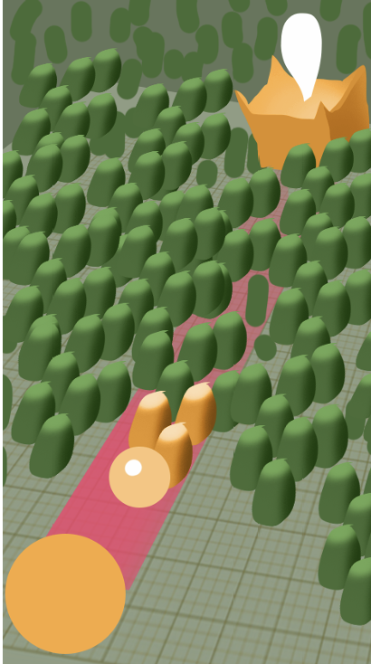

# ТЗ прототипу: гіпер-кежуал «куля-постріл» (тестове завдання)

> Unity 6000.6.5 · Android · 3D · URP · DOTween + UniTask · без DI-фреймворку
> Репозиторій: https://github.com/Silvedko/SelfBulletting
> Статус: чернетка v2. Відкриті питання позначені ⚠ і зібрані в розділі 14.



---

## 1. Суть

Куля-гравець стоїть у лівому нижньому куті, фініш із дверима — у правому верхньому. Між ними густо стоять перешкоди.
Куля не рухається, поки шлях не розчищено: вона стріляє частиною себе. Кожен постріл зменшує кулю, влучає в першу перешкоду на шляху й підриває всі перешкоди в радіусі ураження.
Щойно коридор шириною з кулю вільний до самого фінішу, куля стрибками котиться до дверей. Хто перекачав себе в постріли — програв.

У грі три режими, їх обирають кнопками в меню:
- **Класика** — пряма доріжка, постріл котиться по ній до першої перешкоди (розділи 4.1–4.5);
- **Рогатка** і **Стрілка** — режими прицілу: доріжка до дверей крива, а постріл летить дугою над вогнищами в точку, яку обирає гравець (розділ 4.6).

## 2. Що на екрані (за референсом)

- Земля з сіткою. Камера перспективна, фіксована, зверху під кутом. Весь рівень у кадрі, портретна орієнтація.
У референсі куля помаранчева, а перешкоди — зелені капсули. У грі той самий набір переосмислено як «вода гасить вогонь»; правила, розміри й фізика від цього не змінюються.

- **Куля-гравець** — велика крапля води в лівому нижньому куті: напівпрозора синя, з відблисками, трохи тремтить, як желе. Нижня половина — точна сфера радіуса кулі, тож крапля така сама завширшки, як куля в геймплеї, і торкається землі в тій самій точці. Верхня половина витягнута в носик, нахилений до камери, щоб згори було видно форму краплі.
- **Доріжка** — темна синьо-сіра «мокра» смуга на землі від кулі до фінішу. Ширина = діаметр кулі, звужується разом із нею. У Класиці вона пряма, у режимах прицілу — плавна крива.
- **Перешкоди** — вогнища однакового розміру, сотні штук, розставлені рандомно (рівень згенеровано заздалегідь). Тіло полум'я завширшки з колайдер (радіус 0,35 м) і заввишки ~1,4 м, як колишня капсула.
- **Влучання** — постріл розбризкується: з точки дотику летять краплі, по землі розбігаються кола, і вода розтікається калюжами від точки влучання разом із хвилею зараження: під кожним вогнищем, до якого дійшла хвиля, з'являються калюжа й кільце, сусідні калюжі зливаються в одну водяну пляму, яка потім висихає.
- **Заражені перешкоди** гаснуть: вода піднімається по полум'ю від основи і робить його блідо-блакитною парою, потім вогнище з шипінням осідає в землю, а з нього виходить хмарка пари й кілька іскор.
- **Постріл** — менша крапля води. На мінімумі шкали вона має власний розмір `ShotStartRadiusPercent`, а далі росте й зменшується разом зі шкалою рівно настільки, наскільки змінюється куля-гравець.
- **Фініш** — помаранчева споруда з дверима і білий маркер-«пін» над нею.
- Земля, фініш і HUD — з примітивів; вогонь і вода — власні шейдери (розділ 12).

## 3. Одиниці

- 1 юніт = 1 метр.
- Розмір гравця `r` — у відсотках від **стартового радіуса R₀** (старт = 100%).
- Зменшення — лінійно через радіус: `r = r − cost`. Нічого зайвого (без площі чи об'єму).
- Світовий радіус кулі = `R₀ × r / 100`.

## 4. Цикл пострілу

Розділи 4.1–4.5 описують Класику. Режими прицілу міняють лише форму доріжки, приціл і політ пострілу (4.6); економіка пострілу, зараження й правила перемоги в усіх режимах спільні.

### 4.1 Прицілювання (утримання тапу)

1. Палець торкнувся екрана → від кулі «відділяється» куля-постріл (з'являється збоку кулі в бік цілі за ~0.15 с) і запускається шкала.
2. Шкала `s` ходить пінг-понгом від 0 до верхньої межі `sMax` і назад з однаковою швидкістю: від 0 до 1 за `AimHalfPeriod` (3 с). Мертвої зони немає: короткий тап = мінімальний постріл.
3. Від `s` залежать дві величини:
   - ціна пострілу: `cost = lerp(MinShootPercent, MaxShootPercent, s)`;
   - радіус ураження: `damageRadius = R₀ × lerp(DamageRadiusMinPercent, DamageRadiusMaxPercent, s) / 100`.
4. **Верхня межа шкали обрізається під залишок.** Куля ніколи не стає меншою за `MinShootPercent` (критичний розмір), тому дорожче за залишок понад мінімум (`a = r − MinShootPercent`) вистрілити не можна:
   - `sMax = clamp01((a − MinShootPercent) / (MaxShootPercent − MinShootPercent))`;
   - поки `a ≥ MaxShootPercent`, `sMax = 1`, і шкала повна;
   - коли залишку менше, шкала відбивається від `sMax`, як від максимуму, а недоступна частина шкали в UI затемнена;
   - відпустив на `sMax` → постріл забирає все понад мінімум, куля стає `MinShootPercent`. Це **останній постріл**, далі перевірка шляху (розділ 5).
5. Прев'ю синхронно зі шкалою:
   - шкала в UI, від мінімуму до максимуму;
   - куля-постріл росте рівно настільки, наскільки зменшується куля-гравець: радіус пострілу = `ShotStartRadiusPercent + (cost − MinShootPercent)` (% R₀), зокрема й для останнього пострілу. `ShotStartRadiusPercent` не менший за `MinShootPercent`;
   - кільце радіуса ураження на землі навколо точки дотику, «дихає» разом зі шкалою. Точка дотику рахується щокадру (4.2): що більший постріл, то раніше й в іншому місці він може торкнутися перешкоди, і кільце переїжджає туди;
   - куля-гравець зменшується і росте до `r − cost` («маса перетікає в постріл»), але не нижче `MinShootPercent`. Маса списується тільки при пострілі;
   - доріжка звужується і розширюється разом із кулею (ширина = діаметр прев'ю), а в зоні попередження пульсує разом із нею.
6. Попередження: прев'ю `r − cost ≤ WarningPercent` (15%) → пульсація кулі + вібрація. Що ближче до `MinShootPercent`, то частіше.

Коли понад мінімум лишилось більше за 0, але не більше за `MinShootPercent` (`0 < a ≤ MinShootPercent`), шкали немає: постріл вилітає одразу після тапу (розділ 5).

**Приклад** (`Min` = 10%, `Max` = 40%, радіус ураження 30–200%): у кулі r = 35%, понад мінімум a = 25%. Шкала обрізана: ціна від 10% до 25%, радіус ураження від 30% до 115%. Відпустив на 18% — у кулі лишилось 17%, гра триває. Відпустив на верхній межі (25%) — куля стає 10%, далі перевірка шляху.

### 4.2 Постріл

1. **Перешкода на шляху** визначається на початку прицілювання: `Physics.SphereCastNonAlloc` від центру кулі в бік фінішу, радіус = поточний радіус кулі, маска = `Obstacle`. Результати не відсортовані, тому беремо хіт із мінімальною `distance`.
2. **Ціль і точка дотику** рахуються щокадру для поточного розміру пострілу (`ShotTargeting`), тож під час прицілювання ціль може змінюватися разом із розміром:
   - постріл стартує перед кулею (на відстані «радіус кулі після пострілу + радіус пострілу») і котиться прямо по осі доріжки;
   - сфера пострілу «проганяється» по осі аж до фінішу; перша перешкода, якої вона справді торкнеться, — ціль, а точка дотику на її поверхні — точка влучання;
   - тому великий постріл може зачепити перешкоду на краю коридору, а менший прокотиться повз неї до наступної перешкоди на своїй лінії;
   - якщо на осі взагалі нічого немає (лишилися тільки перешкоди на краях коридору), постріл котиться до перешкоди з п. 1 і торкається її — постріл не пропадає.
3. Палець відпущено → `r = r − cost` (фіксуємо), постріл котиться до точки дотику зі швидкістю `ShotSpeed`.
3. Під час польоту і вибухів ввід заблоковано.

### 4.3 Зараження і вибухи

1. У точці влучання: `Physics.OverlapSphereNonAlloc(point, damageRadius, Obstacle)`.
2. Знайдені перешкоди сортуються за відстанню від точки влучання.
3. Каскад від найближчої: на перешкоду на `InfectDuration` піднімається вода (вогонь блідне знизу вгору), потім вона «вибухає» — гасне з хмаркою пари й осідає в землю — і вимикається. Тривалість згасання та сама, що була у вибуху (0,08 + 0,15 с). Затримка кожної = `distance / InfectionWaveSpeed`, тож виходить хвиля від точки влучання.
4. Над кожною перешкодою, що вибухнула, з'являється «+10». Після каскаду рахується комбо (розділ 7) і оновлюється індикатор залишку кулі в HUD.
5. Перешкода, в яку влучив постріл, вибухає завжди (вона на відстані ~0).

### 4.4 Перевірка доріжки

Після каскаду: SphereCast від кулі до фінішу з **новим** радіусом.

- Хітів немає → **перемога**, фінальна послідовність (4.5).
- Хіти є → правила з розділу 5.

Рожева смуга анімовано звужується до нової ширини.

### 4.5 Фінальна послідовність

1. Куля стрибками (`DOJump`: `HopLength`, `HopHeight`, `HopDuration`) котиться по центру доріжки до фінішу.
2. На відстані ≤ `DoorOpenDistance` (5 м) двері відчиняються.
3. Куля заходить у двері → стан Final (перемога).

### 4.6 Режими прицілу: Рогатка і Стрілка

**Крива доріжка**

- Плавний сплайн (центрипетальний Catmull-Rom, без петель і викидів між близькими точками) через старт, опорні точки рівня (діти `Level → Path` по порядку) і фініш. Сплайн розбивається на ламану з кроком ~0,5 м (`GroundPath`). Пряма доріжка Класики — та сама ламана з двох точок, тож решта коду спільна.
- Перешкода на шляху (4.2, п. 1) і перевірка доріжки (4.4) — `SphereCast` радіуса кулі по кожному відрізку ламаної по черзі. Перешкода на шляху — перша влучена вздовж доріжки, а не найближча до кулі.
- Доріжка на землі — стрічка-меш уздовж ламаної, ширина = діаметр кулі, як у Класиці.
- Фінальні стрибки (4.5) йдуть уздовж кривої рівними кроками не довше `HopLength`. Двері відчиняються, коли до них лишилось не більше `DoorOpenDistance` по доріжці. Фінішна будівля повернута вздовж останнього відрізка кривої.

**Постріл дугою**

- Постріл летить навісом над вогнищами до точки падіння й не зачіпає нічого між ними. Перешкоди «прямого влучання» немає: хвиля зараження (4.3) починається в точці падіння — там, де центр пострілу торкається землі.
- Промах можливий: якщо в радіусі ураження немає вогнищ, вода просто розбризкується, а маса все одно витрачається.
- Точка падіння лежить на прямій від центру кулі в напрямку прицілу, на відстані `lerp(Lob.MinRange, Lob.MaxRange, частка дальності)`. Вона не виходить за межі поля рівня (`Level.Field`) і не буває ближчою за сам постріл перед кулею.
- Висота дуги = `max(Lob.MinApexHeight, дальність × Lob.ApexHeightPerMeter)`, горизонтальна швидкість — `ShotSpeed`. Прев'ю й політ беруть ту саму параболу (`ArcPath`).
- Ціна пострілу, радіус ураження, розмір пострілу, обрізання шкали під залишок і попередження — як у 4.1, через те саме значення шкали `s`. Звідки береться `s`, залежить від режиму: у Рогатці це пінг-понг під час утримання, у Стрілці його задає дальність.

**Рогатка**

1. Палець ставиться будь-де → стартує пінг-понг шкали (як у 4.1, одночасно з наведенням).
2. Палець тягнеться назад, постріл летить у протилежний бік. Напрямок рахується на землі: точку дотику й поточну точку пальця камера проектує на землю.
3. Довжина тягу (частка висоти екрана) задає дальність: на межі мертвої зони `Slingshot.DeadZoneScreenShare` (5%) — найкоротша, від `Slingshot.FullPullScreenShare` (40%) і далі — найдовша. Сила пострілу (шкала) і дальність незалежні.
4. Відпустив — постріл. Відпустив у мертвій зоні — скасування: нічого не витрачено, шкала скидається, наступний дотик починає заново.

**Стрілка** (два тапи, утримувати палець не треба)

1. Стрілка на землі біля кулі сама хитається в секторі `Arrow.SectorWidthDegrees` (90°) з серединою `Arrow.SectorCenterDegrees` (45°): від «вгору» (+Z) до «праворуч» (+X) за `Arrow.SwingHalfPeriodSeconds` (1,2 с) і назад.
2. Перший тап фіксує напрямок.
3. Точка падіння сама ходить уздовж стрілки пінг-понгом: від найкоротшої дальності до найдовшої за `Arrow.RangeHalfPeriodSeconds` (1,5 с) і назад. Частка дальності `d` = 0 на найкоротшій і 1 на найдовшій.
4. **Розмір пострілу зменшується з дальністю:** `s = 1 − d`. На найкоротшій дальності — найбільший постріл (`MaxShootPercent`, найбільший радіус ураження), на найдовшій — мінімальний. Далека ціль дешева, але слабка. Коли куля вже не може дозволити великий постріл, дальність не обрізається: близькі дальності дають найбільший доступний постріл (`s` обрізається під `sMax`, як у 4.1, п. 4).
5. Другий тап — постріл туди, де точка падіння зараз. Тап, що зафіксував напрямок, другим не рахується: перевірка починається з наступного кадру.

**Останній постріл** (`0 < a ≤ MinShootPercent`, розділ 5): приціл лишається, шкали немає. Ціна — увесь залишок понад мінімум, радіус ураження мінімальний, напис «Останній постріл» з підказкою «aim and fire». Напис ховається, поки гравець прицілюється, щоб не закривати поле. У Рогатці дальність задає тяг. У Стрілці точка падіння так само ходить уздовж стрілки, але розмір від дальності вже не залежить.

**Прев'ю** (щокадру, поки гравець прицілюється: у Рогатці — поки палець на екрані, у Стрілці — між першим і другим тапом):

- пунктирна дуга з крапок, які течуть до точки падіння;
- кільце ураження в точці падіння;
- вогнища всередині кільця підсвічуються блакитним (`IObstacleView.SetHighlighted`);
- шкала в HUD (крім останнього пострілу); у Стрілці вона показує розмір, що йде від дальності;
- куля-постріл перед кулею в напрямку прицілу; куля й доріжка звужуються, як у 4.1;
- у Стрілці — ще й стрілка.

Рівні режимів прицілу і прогрес — розділ 10.8.

## 5. Перемога і програш

Критичний розмір кулі = `MinShootPercent`, окремої константи немає.

Куля ніколи не стає меншою за `MinShootPercent`.

**Перевірка після кожного пострілу:**

| Стан після пострілу | Результат |
|---|---|
| Доріжка вільна | **Перемога** |
| Доріжка не вільна, `r > MinShootPercent` | Наступний постріл (таблиця нижче) |
| Доріжка не вільна, `r = MinShootPercent` | **Поразка**: не вистачило пострілів |

**Яким буде наступний постріл** (залишок понад мінімум `a = r − MinShootPercent`):

| Залишок | Постріл |
|---|---|
| `a ≥ MaxShootPercent` | Звичайний: повна шкала, ціна від `Min` до `Max` |
| `MinShootPercent < a < MaxShootPercent` | Шкала обрізана під залишок (4.1, п. 4). Відпустив на верхній межі → куля стає `Min`, це останній постріл |
| `0 < a ≤ MinShootPercent` | **Останній постріл без шкали**: усе, що лишилось понад мінімум, з мінімальним радіусом ураження. У Класиці його стріляє тап, у режимах прицілу він прицілюється без шкали (4.6). Куля стає `Min` |
| `a = 0` | Стріляти нічим: якщо доріжка не вільна — **поразка** (таблиця вище) |

- Після останнього пострілу куля мінімальна, тож перевірка шляху вирішує все: прохід вільний — перемога, ні — поразка.
- Коли постріл буде останнім без шкали, у HUD видно напис «Останній постріл» (у Класиці з підказкою «tap to fire», у режимах прицілу — «aim and fire»).
- Варіант «стріляємо, поки радіус не дійде до 0» прибрано.
- Межі при `Min` = 10%, `Max` = 40%: від 50% — повна шкала; від 20% до 50% — шкала обрізана; від 10% до 20% — останній постріл без шкали; 10% із закритою доріжкою — поразка.

## 6. Попередження

- **Візуал:** пульсація масштабу кулі (DOTween, `SetLoops(-1, LoopType.Yoyo)`). Частота росте від `WarningPercent` до `MinShootPercent`.
- **Вібрація (Android):** короткі імпульси `VibrationPulseMs`, інтервал зменшується від `VibrationIntervalMaxMs` до `VibrationIntervalMinMs`.
- Працює тільки під час утримання.

## 7. Очки і комбо

- `PointsPerObstacle` (10) за кожну перешкоду, що вибухнула, включно з тими, що поза доріжкою.
- **Комбо** = кількість перешкод, знищених одним пострілом. Від 3 штук — множник за таблицею з конфігу:

  | Перешкод за постріл | Множник |
  |---|---|
  | 3+ | ×1.5 |
  | 6+ | ×2 |
  | 10+ | ×3 |

- Очки пострілу = `count × PointsPerObstacle × multiplier`.
- **Бонус за залишок кулі** (тільки при перемозі): `PointsPerRemainingPercent` (30) за кожен відсоток кулі понад критичний розмір, що лишився на фініші. Приклад: куля дійшла з 35% → понад мінімум 25% → +750.
  - Чому 30: постріл заробляє приблизно 5–26 очок на кожен витрачений відсоток (від маленького пострілу в одну перешкоду до великого комбо ×3). Тож кожен збережений відсоток вартий більше, ніж витрачений на зайві перешкоди, і є сенс розчищати шлях економно.
- У грі: «+10» над кожним вибухом, біля точки влучання — «КОМБО ×2». Звук комбо яскравішає з рівнем: `Combo` (3+), `ComboBig` (6+), `ComboHuge` (10+).
- Угорі — індикатор залишку кулі, оновлюється після кожного пострілу. Загального лічильника очок у HUD немає.
- Фінальний екран: анімований підрахунок «перешкоди → бонус комбо → бонус за кулю → разом».
- Очки нараховуються в загальний рахунок і при перемозі, і при програші.
- Загальний рахунок зберігається в PlayerPrefs окремо для кожного режиму і показується в меню на кнопці свого режиму.

## 8. Звук

- Геймплей і UI викликають `IAudioService`: `Play(SoundId)`, `StartLoop(SoundId)`, `StopLoop(SoundId)`.
- `SoundId`: `UiClick`, `AimCharge` (луп під час утримання), `ShotFire`, `Infect`, `Explode`, `Combo`, `ComboBig`, `ComboHuge`, `Warning`, `LastShot`, `DoorOpen`, `Hop`, `Win`, `Lose`. Нові значення дописуються в кінець переліку: `SoundLibrary` зберігає їх як числа.
- `SoundLibrary` (`Audio/SoundLibrary.asset`): `SoundId` → кліп і параметри відтворення, плюс розмір пулу голосів.
- `AudioService` створює `Bootstrap`. Одноразові звуки грають через невеликий пул `AudioSource` з обмеженням копій на звук, щоб хвиля вибухів не накладала десятки однакових звуків. Для лупа є окреме джерело. Джерела живуть у сцені Boot.
- Якщо `SoundLibrary` не підключено, `Bootstrap` підставляє `NullAudioService`, і гра йде без звуку. Тести теж використовують `NullAudioService`.
- Кліпи згенеровано скриптом `Audio/Source~/generate_sounds.py` (папку з `~` Unity не імпортує).
- `Explode` під тему «вода гасить вогонь» звучить як шипіння згаслого вогнища: пара, що спадає за висотою і булькає, тихий сплеск на початку й кілька останніх тріскотів, 0,3 с. Гучність у бібліотеці 0,4 (шипіння на слух гучніше за колишній вибух), розкид висоти ±15% лишився, тож хвиля не звучить механічно. Шипіння бере зі спільного генератора випадкових чисел рівно стільки шуму, скільки брав вибух, тож решта кліпів при перегенерації не змінюється.
- `ShotFire` — сплеск води замість «лазерного» звуку: булькання, бризки й кілька крапель, що падають слідом, 0,28 с. Сплеск різкіший і на слух тихіший за колишній звук, тому гучність у бібліотеці 1,0. За тим самим правилом бере зі спільного генератора лише один буфер шуму.

## 9. Стейти і сцени

```
Loading → Menu → Game → Final ─┬─ «В меню»          → Menu
                               └─ NEXT / RETRY      → Game (рівень з нуля)
```

| Стан | Завантажені сцени | Що відбувається |
|---|---|---|
| Loading | Boot | Заставка з прогрес-баром, поки асинхронно вантажиться Menu |
| Menu | Boot + Menu | Кнопки режимів CLASSIC, SLINGSHOT, ARROW; на кожній — поточний рівень і загальний рахунок цього режиму. Натиск запускає гру в режимі |
| Game | Boot + Game | Геймплей |
| Final | Boot + Game | Оверлей поверх замороженої гри: результат, підрахунок очок, кнопки NEXT / RETRY і «В меню» |

- Після перемоги поточним стає наступний рівень режиму (після останнього — знову перший), і кнопка гри називається NEXT. Після поразки рівень лишається той самий, кнопка — RETRY. Обидві кнопки лишаються в тому самому режимі, а очки йдуть у рахунок цього режиму.
- Обидві кнопки вивантажують сцену Game і вантажать її заново під шторкою з поточним рівнем — той самий шлях, що й вхід із меню, тому окремого коду скидання рівня немає.

- `Boot` завантажена завжди. `Menu` і `Game` вантажаться адитивно і повністю вивантажуються при виході. Кожен вхід у гру — з нуля, жоден стан рівня не переживає перезапуск.
- Переходи Menu ↔ Game — під тією ж шторкою завантаження.
- Після вивантаження `Game` викликається `Resources.UnloadUnusedAssets()`.

## 10. Архітектура

### 10.1 Принципи

- **Ручне впровадження залежностей.** `Bootstrap` створює сервіси, стани отримують їх через конструктор, сцени — через `EntryPoint.Construct(...)`. Ні статики, ні сервіс-локатора, ні DI-фреймворку.
- **Два часи життя.**
  - Застосунок (сцена Boot): сервіси і стейт-машина.
  - Сцена (Menu, Game): усе інше.
  - Сервіс застосунку ніколи не тримає посилань на об'єкти сцени. EntryPoint сцени збирає підписки й ресурси і звільняє їх в `OnDestroy`.
- **Об'єкти сцени.** Унікальні речі (куля, фініш, перешкоди, камера, HUD) стоять у сцені й приходять в EntryPoint через `[SerializeField]`. Фабрики й пули (`UnityEngine.Pool.ObjectPool`) — тільки для того, що з'являється під час гри: постріл, «+10», вибухи.
- **Логіка окремо від показу.** Формули й правила — у класах на чистому C# без MonoBehaviour, їх покривають EditMode-тести. MonoBehaviour тільки показують і анімують.
- **Без глобальної шини подій.** `GameLoop` напряму викликає моделі й чекає на анімації в'юшок. Події в моделях — лише для стану, який видно постійно (радіус кулі → розмір кулі й ширина доріжки).
- **Інтерфейси — тільки де є друга реалізація або тест:** `IInputService`, `IVibrationService`, `IAudioService`, `ISaveService`.

### 10.2 Скелет

```
Boot (завантажена весь час)
└─ Bootstrap
   ├─ сервіси застосунку: SceneLoader, LoadingCurtain, SaveService,
   │  InputService, VibrationService, AudioService, SettingsConfig
   └─ AppStateMachine: Loading → Menu → Game → Final → Menu | Game

Menu (адитивно)  MenuEntryPoint.ShowMode(...) → MenuScreen → ModeButton × 3
Game (адитивно)  GameEntryPoint.Construct(dependencies, level, mode)
   ├─ доріжка: GroundPath (пряма в Класиці, крива в режимах прицілу)
   ├─ моделі, чистий C#: Ball, AimScale, ShotEconomy, RoundRules, Score
   ├─ приціл (IShotAiming): ClassicAimController | SlingshotAimController | ArrowAimController
   ├─ фізика: PathScanner, ObstacleScanner (буфери NonAlloc)
   ├─ GameLoop (UniTask): перевірка доріжки → приціл → постріл → каскад → знову
   └─ в'юшки: BallView, ShotView, ObstacleView, PathView, AimView, LobAimView, Hud, FinalScreen
```

### 10.3 Стейт-машина застосунку

- `IState.EnterAsync(ct)`, `IPayloadState<TPayload>.EnterAsync(payload, ct)`, `IExitableState.ExitAsync(ct)` — асинхронні, бо всередині вантажаться сцени.
- `AppStateMachine.Enter<TState>()` виконує переходи по одному. Поки триває перехід, нові запити ігноруються, тож подвійний тап по кнопці не запустить завантаження двічі.

| Звідки | Куди | Коли |
|---|---|---|
| Loading | Menu | Menu завантажено (заставка висить щонайменше `LoadingMinDuration`) |
| Menu | Game | Кнопка режиму: `Enter<GameState, GameMode>(mode)` |
| Game | Final | Раунд завершився, `GameResult` |
| Final | Game | NEXT / RETRY: Game вивантажується і вантажиться заново з поточним рівнем того самого режиму |
| Final | Menu | «В меню» |

- `GameState` отримує режим як payload і бере поточний рівень режиму з `ModeLevels`.
- `GameState` передає у `FinalState` результат, посилання на сцену і режим: `FinalPayload { GameResult, GameEntryPoint, GameMode }`. `FinalState` показує екран, нараховує очки в рахунок режиму, після перемоги переводить прогрес режиму на наступний рівень і вивантажує Game тільки після вибору гравця.

### 10.4 Раунд

`GameLoop` — лінійний async-цикл на UniTask, скасовується токеном сцени. Режиму гри він не знає: доріжку (`GroundPath`) і приціл (`IShotAiming`) для режиму збирає `GameEntryPoint`. Псевдокод:

```csharp
while (true)
{
    bool isBlocked = _pathScanner.TryFindFirstObstacle(_path, _ball.WorldRadius, out RaycastHit blocker);
    RoundOutcome outcome = _rules.Evaluate(!isBlocked, _ball.RadiusPercent);
    if (outcome == RoundOutcome.Win) { await _winSequence.PlayAsync(_path, ct); return GameResult.Finish(_score.Summary); }
    if (outcome == RoundOutcome.Lose) return GameResult.Lose(_score.Summary);

    ShotMode mode = _economy.GetShotMode(_ball.RadiusPercent);          // Aimed / Instant
    FiredShot shot = await _aim.TakeShotAsync(mode, blocker, ct);       // Класика котить, режими прицілу кидають дугою

    _ball.Spend(shot.Request.CostPercent);
    if (shot.IsLob) await _views.Shot.LobAsync(shot.Lob.Arc, _economy.ShotSpeed, ct);
    else await _views.Shot.FlyAsync(shot.Target.ContactCenter, _economy.ShotSpeed, ct);

    int destroyed = await _cascade.RunAsync(shot.ImpactPoint, shot.Request.DamageWorldRadius, directHit, ...);
    _score.AddShot(destroyed);
}
```

### 10.5 Структура

```
Assets/Project/
  Configs/       SettingsConfig.asset, LevelCatalog.asset (Класика), CurvedLevelCatalog.asset (режими прицілу)
  Materials/     Fire, Ball і Shot (вода), Steam, WaterPuddle, WaterRipple, Path, DamageZone, AimDot, AimArrow …
  Meshes/        FlameQuad (квад вогнища з розширеними межами для відсікання)
  Shaders/       Fire (полум'я), WaterDrop (крапля)
  Textures/      FlameNoise, SteamPuff, WaterRipple, WaterPuddle; Source~/generate_fx_textures.py
  Levels/        Level_01 (Класика), Level_02 … Level_04 (криві рівні)
  Prefabs/       Obstacle (вогнище), FloatingText
  Scenes/        Boot, Menu, Game
  Scripts/       SelfBulletting.Runtime.asmdef
    Infrastructure/  Bootstrap, StateMachine/, States/, Services/
    Configs/         SettingsConfig і його розділи
    Gameplay/        GameEntryPoint, GameLoop, GameDependencies, GameResult
      Aim/           IShotAiming, ClassicAimController, SlingshotAimController, ArrowAimController,
                     AimScale, SlingshotPull, ArrowSwing, ChargePreview, LobPreview, TargetHighlight
      Ball/          BallModel
      Feedback/      DangerFeedback
      Finish/        HopPath, WinSequence
      Levels/        Level, LevelCatalog, LevelProgress, ModeLevels
      Modes/         GameMode
      Paths/         GroundPath, CatmullRomSpline
      Obstacles/     Obstacle, ObstacleCascade
      Rules/         RoundRules
      Scanning/      PathScanner, ObstacleScanner
      Score/         ScoreCounter, ShotScore, ScoreSummary
      Shot/          ShotEconomy, ShotRequest, ShotMode, ShotTargeting, LobTargeting, ArcPath, FiredShot
      Presentation/  інтерфейси в'юшок, Null/
    Views/           реалізації в'юшок
    UI/              LoadingCurtain, Menu/, Final/
  Editor/        SelfBulletting.Editor.asmdef, BootSceneOnPlay, LevelGeneration/
  Tests/EditMode/  SelfBulletting.Tests.EditMode.asmdef
```

Простори імен повторюють папки: `SelfBulletting.Infrastructure.States`, `SelfBulletting.Gameplay.Aim` тощо. Папка з фізичними запитами називається `Scanning`, а не `Physics`: інакше простір імен `...Gameplay.Physics` перекрив би `UnityEngine.Physics`.

### 10.7 Контракт відображення

Геймплей не знає, як виглядає гра: він говорить з в'юшками лише через інтерфейси з `Gameplay/Presentation`. Справжні в'юшки робляться окремо, тут потрібні лише їхні реалізації.

| Інтерфейс | Що показує | Де підключається |
|---|---|---|
| `IBallView` | Куля: розмір (поточний або прев'ю), пульсація (`SetDanger` 0..1), стрибки до фінішу | поле `_ballView` у `GameEntryPoint` |
| `IShotView` | Куля-постріл: щокадру під час утримання стоїть перед кулею з розміром від економіки пострілу, потім у Класиці котиться до точки дотику (`FlyAsync`), а в режимах прицілу летить дугою (`LobAsync`, `ArcPath`). Позиції рахує геймплей | `_shotView` |
| `IPathView` | Доріжка: ламана з точок на землі (дві для прямої), ширина = діаметр кулі, пульсує разом із кулею | `_pathView` |
| `IAimView` | Шкала в HUD (недоступна частина затемнена), кільце ураження на землі (центр і радіус міняються щокадру, його можна сховати), напис «Останній постріл» (`isAimed` міняє підказку) | `_aimView` |
| `ILobAimView` | Режими прицілу: пунктирна дуга пострілу і стрілка біля кулі | `_lobAimView` |
| `IScreenToGround` | Проектує точку екрана на землю через камеру, щоб тяг рогатки став напрямком на землі | `_screenToGround` (`ScreenToGroundPicker` на камері) |
| `IScoreView` | «+10» над кожним вибухом, «КОМБО ×N» у точці влучання | `_scoreView` |
| `IDoorView` | Двері на фініші; геймплей сам вирішує, коли їх відчинити (5 м) | `_doorView` |
| `IObstacleView` | Зараження (вода піднімається по вогнищу), «вибух» однієї перешкоди (вогнище гасне з парою й осідає) і підсвітка, поки перешкода в кільці ураження прицілу | компонент на префабі перешкоди, поруч з `Obstacle` |
| `IBallHealthView` | Залишок кулі в HUD: смуга від критичного розміру до повного і «35%». Оновлюється тільки після вибухів, під час прицілювання не змінюється і не пульсує | `_healthView` |
| `ILevelView` | Підганяє спільну сцену під завантажений рівень: ставить фінішну будівлю з дверима на фініш і повертає вздовж останнього відрізка доріжки, роздає перешкодам ефект пари (`SteamPuffEffect`), кадрує камеру. Викликається один раз після завантаження рівня | `_levelView` |

- Геймплей передає точки на землі; в'юшка сама піднімає кулю на її радіус.
- Будь-яку в'юшку можна не підключати: її замінить Null-реалізація, і раунд усе одно пройде.
- Реалізації лежать у `Scripts/Views/` (`BallView`, `ShotView`, `PathView`, `AimView`, `LobAimView`, `ScreenToGroundPicker`, `ScoreView`, `DoorView`, `ObstacleView`, `BallHealthView`, `LevelPresenter`). Вигляд краплі й вогню задають матеріали й шейдери, тож рескін не чіпає геймплей.
- Звуки (`IAudioService`) і вібрація (`IVibrationService`) викликаються з геймплею, в'юшкам їх робити не треба.

### 10.8 Рівні і генератор

- **Рівень — префаб** у `Assets/Project/Levels/` з компонентом `Level` на корені: точки `Start` (лівий нижній кут), `Finish` (правий верхній) і корінь `Obstacles`. Кривий рівень має ще корінь `Path` з опорними точками (`Waypoint_N`, по порядку) і поле `Field` — прямокутник поля, за який не падають постріли дугою. У Scene View крива й поле видно як гізмо.
- **Два каталоги.** `Configs/LevelCatalog.asset` — рівні Класики, `Configs/CurvedLevelCatalog.asset` — криві рівні, спільні для Рогатки і Стрілки. `Bootstrap` бере обидва, `ModeLevels` вирішує, який каталог грає режим.
- **Прогрес окремий для кожного режиму**: `LevelProgress` зберігає поточний рівень режиму, а рахунок режиму — `ISaveService`. Ключі PlayerPrefs Класики лишилися старі (`level_index`, `total_score`), щоб збережений прогрес не пропав; режими прицілу дописують суфікс (`level_index_slingshot`, `total_score_arrow`).
- **Сцена Game спільна для всіх рівнів:** камера, земля, UI, в'юшки. `GameEntryPoint` створює префаб поточного рівня під `LevelRoot`, а `ILevelView` (`LevelPresenter`) підганяє під нього двері й камеру.
- **Новий рівень:** меню **SelfBulletting → Level → Create New Level** (Класика) або **Create New Curved Level** (режими прицілу). Створюється `Level_NN.prefab` з наступним вільним номером у папці, зі стартом і фінішем першого рівня свого каталогу. Перешкоди генеруються з seed `налаштування + номер у каталозі`, для кривих рівнів — ще й крива, а seed зсунуто на 100, щоб розстановка не повторювала Класику. Рівень додається в кінець свого каталогу й відкривається в Prefab Mode для доведення руками.
- Перешкода — префаб з колайдером і компонентом `Obstacle` на корені, шар `Obstacle`. Маска цього шару задана в `SettingsConfig → Physics`.
- Генератор: меню **SelfBulletting → Level → Generate Obstacles** перегенеровує рівень, відкритий у Prefab Mode. Налаштування (seed, область, розмір клітинки, розкид, чисті зони біля старту й фінішу, префаб) лежать в `Editor/LevelGeneration/LevelGenerationSettings.asset`; швидкий перехід до них — **Select Generation Settings**.
- Розстановка — сітка з випадковим зсувом у кожній клітинці. Той самий seed завжди дає той самий рівень. Кожен запуск замінює попередні перешкоди і підтримує Undo, тож після генерації рівень можна доводити руками.
- **Крива:** меню **SelfBulletting → Level → Generate Path** перегенеровує опорні точки рівня, відкритого в Prefab Mode (створює корінь `Path`, якщо його немає, і ставить `Field` = область генератора). Точки стоять рівномірно вздовж прямої старт → фініш і по черзі зсуваються вбік на випадкову відстань від `BendOffsetMin` до `BendOffsetMax`, не ближче `PathMargin` до краю області. Кількість вигинів — `BendCount`. Той самий seed — та сама крива, Undo підтримується; точки можна посунути руками.
- Зараз чотири рівні. Класика: `Level_01` (299 перешкод). Криві рівні: `Level_02` (302 перешкоди, 1 вигин, доріжка 22,3 м), `Level_03` (300 перешкод, 2 вигини, 25,0 м), `Level_04` (301 перешкода, 3 вигини, 29,6 м). Перешкоди — префаб `Prefabs/Obstacle` (вогнище).

### 10.6 Стиль коду

- Microsoft C# Coding Conventions + Clean Code. Правила форматування й іменування зафіксовані в `.editorconfig`.
- PascalCase для типів, методів і властивостей, `_camelCase` для приватних полів, префікс `I` для інтерфейсів, суфікс `Async` для асинхронних методів.
- `[SerializeField] private` замість публічних полів, один тип на файл, класи `sealed`, якщо не задумані для наслідування.
- Clean Code: короткі методи з одним завданням, імена замість коментарів, жодних «магічних чисел» — усе в `SettingsConfig`.

## 11. SettingsConfig (ScriptableObject)

«Дефолт» — значення в коді (ним заповнюється новий конфіг), «У грі» — що стоїть зараз у `Configs/SettingsConfig.asset`. Приклади в розділах 4–5 рахують з дефолтами.

| Поле | Дефолт | У грі | Опис |
|---|---|---|---|
| `StartRadius` | 1.5 м | 1.5 м | R₀, стартовий радіус кулі |
| `MinShootPercent` | 10 | 5 | ціна мінімального пострілу і водночас критичний розмір кулі, % R₀ |
| `MaxShootPercent` | 40 | 25 | ціна максимального пострілу, % R₀ (`Min < Max < 100`) |
| `WarningPercent` | 15 | 15 | прев'ю нижче цього — пульсація і вібрація |
| `AimHalfPeriod` | 3 с | 3 с | шкала від мінімуму до максимуму |
| `DamageRadiusMinPercent` | 30 | 35 | радіус ураження на мінімумі шкали, % R₀ |
| `DamageRadiusMaxPercent` | 200 | 200 | максимальний радіус ураження (на максимумі шкали), % R₀ |
| `ShotStartRadiusPercent` | 20 | 7 | радіус кулі-пострілу на мінімумі шкали, % R₀ (не менше `MinShootPercent`); далі вона росте на стільки, на скільки зменшується куля-гравець |
| `ShotSpeed` | 15 м/с | 15 м/с | швидкість пострілу (у режимах прицілу — горизонтальна) |
| `Lob.MinRange` / `MaxRange` | 3 / 24 м | 3 / 24 м | найкоротша й найдовша дальність пострілу дугою від центру кулі; край поля може обрізати менше |
| `Lob.ApexHeightPerMeter` | 0.25 | 0.25 | висота дуги на метр дальності |
| `Lob.MinApexHeight` | 1 м | 1 м | дуга не нижча за це |
| `Slingshot.DeadZoneScreenShare` | 0.05 | 0.05 | тяг коротший за цю частку висоти екрана — прицілу немає, відпускання скасовує постріл |
| `Slingshot.FullPullScreenShare` | 0.4 | 0.4 | тяг такої довжини дає найдовшу дальність |
| `Arrow.SectorCenterDegrees` | 45° | 45° | середина сектора стрілки (yaw світу: 0° — +Z, вгору екрана; 90° — +X, праворуч) |
| `Arrow.SectorWidthDegrees` | 90° | 90° | ширина сектора |
| `Arrow.SwingHalfPeriodSeconds` | 1.2 с | 1.2 с | стрілка від одного краю сектора до іншого |
| `Arrow.RangeHalfPeriodSeconds` | 1.5 с | 1.5 с | після першого тапу точка падіння від найкоротшої дальності до найдовшої |
| `InfectionWaveSpeed` | 8 м/с | 8 м/с | швидкість хвилі зараження |
| `InfectDuration` | 0.15 с | 0.25 с | скільки перешкода «горить» перед вибухом |
| `PointsPerObstacle` | 10 | 10 | очки за перешкоду |
| `ComboTiers` | 3→×1.5, 6→×2, 10→×3 | так само | пороги і множники комбо |
| `DoorOpenDistance` | 5 м | 5 м | коли відчиняються двері (відстань по доріжці) |
| `HopLength` / `HopHeight` / `HopDuration` | 1.5 м / 0.6 м / 0.25 с | так само | стрибки до фінішу |
| `VibrationPulseMs` | 40 | 40 | тривалість імпульсу |
| `VibrationIntervalMaxMs` / `MinMs` | 400 / 120 | 400 / 120 | інтервал між імпульсами |
| `LoadingMinDuration` | 1 с | 1 с | щоб заставка не блимала |
| `Loading.FadeInSeconds` / `FadeOutSeconds` | 0.2 / 0.35 с | так само | шторка плавно з'являється перед вивантаженням сцени і зникає над новою |
| `Score.PointsPerRemainingPercent` | 30 | 30 | бонус на фініші за кожен відсоток кулі понад критичний розмір |
| `Physics.ObstacleMask` | — | шар `Obstacle` | які колайдери вважаються перешкодами |
| `Physics.QueryBufferSize` | 256 | 256 | розмір буферів для NonAlloc-запитів |

`OnValidate` перевіряє: `MinShootPercent < MaxShootPercent < 100`, `MinShootPercent < WarningPercent`, мінімум ≤ максимуму для радіуса ураження і для дальності дуги, повний тяг рогатки довший за мертву зону.

Орієнтовні розміри рівня для генератора: поле ~12 × 24 м, перешкода — капсула r 0.35 м, h 1.4 м, 150–200 штук, чиста зона навколо старту і фінішу.

## 12. Технічні нотатки

- **SphereCastNonAlloc:** буфер `RaycastHit[256]` у полі класу, без алокацій у кадрі. Результати не відсортовані — найближчий хіт шукаємо вручну. Колайдери, які на старті вже перетинають сферу, повертаються з `distance = 0` і `point = Vector3.zero`, тому біля старту чиста зона.
- Каст іде горизонтально на висоті центру кулі. Маска — тільки `Obstacle` (земля, двері, постріл — на інших шарах). `maxDistance` = довжина відрізка; на кривій доріжці відрізки кастяться по черзі.
- **Стрічка доріжки** — меш із двох вершин на кожну точку ламаної; на згинах вершини зсуваються вздовж бісектриси (мітра, не більше ×2), тож ширина на вигинах не провалюється. Вершини переписуються лише тоді, коли змінюється показана ширина.
- **Підсвітка вогнищ у кільці** — тінт `_BaseColor` у тому самому `MaterialPropertyBlock`, що й `_Douse`. `TargetHighlight` щокадру робить один `OverlapSphere` і повідомляє лише ті вогнища, що увійшли в кільце або вийшли з нього.
- **Пунктирна дуга** — 18 маленьких сфер з unlit-матеріалом `AimDot`, які зсуваються вздовж `ArcPath`, тож крапки «течуть» до точки падіння. Стрілка — `LineRenderer`, що лежить на землі (`TransformZ`), наконечник задає крива ширини.
- **Стан вогнища** (`_Douse`: 0 — горить, 1 — пара) міняємо через `MaterialPropertyBlock`, а не `renderer.material`. Інакше кожна перешкода створює копію матеріалу, і копії накопичуються при перезапусках. Блок отримують лише ті кілька вогнищ, що гаснуть.
- **Вогонь на ~300 перешкодах дешевий:** один спільний матеріал (SRP Batcher, GPU instancing) і квад на кожну перешкоду, без систем частинок. Полум'я малюється процедурно: три вкладені «краплі» (зовнішня, середня, ядро), які хитає текстура шуму 128×128, що повзе вгору; фаза мерехтіння береться з позиції, тож сусіди не мерехтять в унісон. Квад розвертається до камери у вершинному шейдері, тому межі меша `FlameQuad` збільшені, щоб відсікання не ховало вогнища біля країв кадру. Тіней вогонь не кидає.
- **Пара** — одна система частинок на сцену (`ObstacleEffects`, плюс дочірня `Sparks` для іскор) з нульовою емісією: кожне згасле вогнище робить `Emit` у своїй точці.
- **Вода, що розтікається** (`WaterSplashEffect` на `WaterEffects`): три системи частинок з нульовою емісією — `Droplets`, `Ripples`, `Puddles` (кола й калюжі — горизонтальні білборди на землі). `ShotView` викликає `PlayImpact`, коли постріл доїхав до точки дотику, а `ObstacleView` — `PlaySpread` у `ShowInfected`. Тож розтікання збігається з хвилею зараження без нових даних від геймплею: ні радіуса, ні швидкості хвилі в'юшкам знати не треба. Матеріали калюж і кіл мають чергу 2980/2985 (трохи раніше за інші прозорі), щоб калюжа на землі не малювалася поверх вогнища, яке стоїть перед нею.
- **Крапля** — шейдер `WaterDrop` на стандартній сфері: прозорість, світлий обідок, відблиск сонця і мультяшне «вікно», носик і желейне тремтіння у вершинному шейдері. Пульсація небезпеки, як і раніше, перефарбовує `_BaseColor` через `MaterialPropertyBlock`.
- Текстури вогню й пари генерує `Textures/Source~/generate_fx_textures.py` (numpy, Pillow); Unity цю папку не імпортує.
- **DOTween:** усім твінам `SetLink(gameObject)`, щоб вони гинули разом з об'єктами при вивантаженні сцени.
- **UniTask:** async-код у сцені бере `destroyCancellationToken`. У кожного стану свій `CancellationTokenSource`, він скасовується в `Exit`.
- **Без статичних подій і синглтонів**, які тримають об'єкти сцени. Кожна підписка має відписку в `Exit` / `OnDisable`.
- **Ввід:** Input System, опитування `Pointer.current.press` в `Update` (миша в редакторі, тач на пристрої). Без колбеків, які можна забути відписати.
- **Вібрація:** `VibrationEffect.createOneShot` через `AndroidJavaClass`. Мінімальний API 26, тому запасний варіант для старих Android не потрібен. Дозвіл `VIBRATE` Unity додає в маніфест, тільки якщо в коді є виклик `Handheld.Vibrate`. Тому `AndroidVibrationService` викликає його як запасний варіант, коли виклик `VibrationEffect` падає з `AndroidJavaException`: і довга вібрація краща за жодну, і дозвіл потрапляє в маніфест.
- **Android:** тільки портрет, `Application.targetFrameRate = 60` (на мобільних за замовчуванням 30 fps), IL2CPP + ARM64 (вимога Google Play), мінімальний API 26.
- **Пакети:** UniTask — з OpenUPM (scoped registry у `manifest.json`). DOTween на OpenUPM немає, тому він імпортується з Asset Store у `Assets/Plugins/Demigiant` і комітиться в репозиторій.
- **Без Git LFS:** усі файли — звичайні git-об'єкти, тож ZIP з GitHub відкривається без проблем.
- **Пули** («+10») і система частинок пари живуть у сцені Game і вмирають разом із нею.
- **Камера** фіксована. Скрипт підганяє FOV, щоб старт і фініш влазили в будь-який портретний екран (від 9:16 до 9:21).

## 13. Поза обсягом

- Запас 20% — левел-дизайн, у коді не враховується.
- Без магазину й вибору рівня в меню: у меню обирається лише режим, рівні в режимі йдуть по черзі.
- Звуки синтезовані скриптом, без ліцензованих бібліотек (розділ 8).
- Без реклами й аналітики.

## 14. Відкриті питання ⚠

Відкритих питань немає. Рівень робиться генератором у редакторі (10.8).
