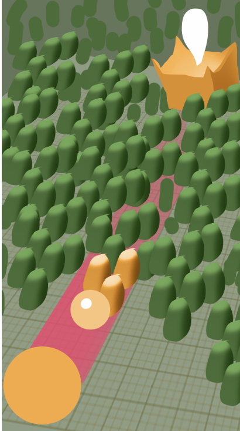

# ТЗ прототипу: гіпер-кежуал «куля-постріл» (тестове завдання)

> Unity 6000.6.5 · Android · 3D · URP · DOTween + UniTask · без DI-фреймворку
> Репозиторій: https://github.com/Silvedko/SelfBulletting
> Статус: чернетка v2. Відкриті питання позначені ⚠ і зібрані в розділі 14.



---

## 1. Суть

Куля-гравець стоїть у лівому нижньому куті, фініш із дверима — у правому верхньому. Між ними густо стоять перешкоди.
Куля не рухається, поки шлях не розчищено: вона стріляє частиною себе. Кожен постріл зменшує кулю, влучає в першу перешкоду на шляху й підриває всі перешкоди в радіусі ураження.
Щойно коридор шириною з кулю вільний до самого фінішу, куля стрибками котиться до дверей. Хто перекачав себе в постріли — програв.

## 2. Що на екрані (за референсом)

- Земля з сіткою. Камера перспективна, фіксована, зверху під кутом. Весь рівень у кадрі, портретна орієнтація.
- **Куля-гравець** — велика помаранчева сфера в лівому нижньому куті.
- **Доріжка** — рожева смуга на землі від кулі до фінішу. Ширина = діаметр кулі, звужується разом із нею.
- **Перешкоди** — зелені капсули однакового розміру, сотні штук, розставлені рандомно (рівень згенеровано заздалегідь).
- **Заражені перешкоди** фарбуються в помаранчевий колір гравця і вибухають.
- **Постріл** — менша світло-помаранчева куля, завжди одного розміру.
- **Фініш** — помаранчева споруда з дверима і білий маркер-«пін» над нею.
- Усе з примітивів-заглушок.

## 3. Одиниці

- 1 юніт = 1 метр.
- Розмір гравця `r` — у відсотках від **стартового радіуса R₀** (старт = 100%).
- Зменшення — лінійно через радіус: `r = r − cost`. Нічого зайвого (без площі чи об'єму).
- Світовий радіус кулі = `R₀ × r / 100`.

## 4. Цикл пострілу

### 4.1 Прицілювання (утримання тапу)

1. Палець торкнувся екрана → від кулі «відділяється» куля-постріл (з'являється збоку кулі в бік цілі за ~0.15 с) і запускається шкала.
2. Шкала `s` ходить пінг-понгом від 0 до верхньої межі `sMax` і назад з однаковою швидкістю: від 0 до 1 за `AimHalfPeriod` (3 с). Мертвої зони немає: короткий тап = мінімальний постріл.
3. Від `s` залежать дві величини:
   - ціна пострілу: `cost = lerp(MinShootPercent, MaxShootPercent, s)`;
   - радіус ураження: `damageRadius = R₀ × lerp(DamageRadiusMinPercent, DamageRadiusMaxPercent, s) / 100`.
4. **Верхня межа шкали обрізається під залишок.** Куля ніколи не стає меншою за `MinShootPercent` (критичний розмір), тому дорожче за залишок понад мінімум (`a = r − MinShootPercent`) вистрілити не можна:
   - `sMax = clamp01((a − MinShootPercent) / (MaxShootPercent − MinShootPercent))`;
   - поки `a ≥ MaxShootPercent`, `sMax = 1`, і шкала повна;
   - коли залишку менше, шкала відбивається від `sMax`, як від максимуму, а недоступна частина шкали в UI затемнена;
   - відпустив на `sMax` → постріл забирає все понад мінімум, куля стає `MinShootPercent`. Це **останній постріл**, далі перевірка шляху (розділ 5).
5. Прев'ю синхронно зі шкалою:
   - шкала в UI, від мінімуму до максимуму;
   - кільце радіуса ураження на землі навколо точки влучання, «дихає» разом зі шкалою;
   - куля-гравець зменшується і росте до `r − cost` («маса перетікає в постріл»), але не нижче `MinShootPercent`. Маса списується тільки при пострілі;
   - рожева доріжка звужується і розширюється разом із кулею (ширина = діаметр прев'ю), а в зоні попередження пульсує разом із нею.
6. Попередження: прев'ю `r − cost ≤ WarningPercent` (15%) → пульсація кулі + вібрація. Що ближче до `MinShootPercent`, то частіше.

Коли понад мінімум лишилось більше за 0, але не більше за `MinShootPercent` (`0 < a ≤ MinShootPercent`), шкали немає: постріл вилітає одразу після тапу (розділ 5).

**Приклад** (`Min` = 10%, `Max` = 40%, радіус ураження 30–200%): у кулі r = 35%, понад мінімум a = 25%. Шкала обрізана: ціна від 10% до 25%, радіус ураження від 30% до 115%. Відпустив на 18% — у кулі лишилось 17%, гра триває. Відпустив на верхній межі (25%) — куля стає 10%, далі перевірка шляху.

### 4.2 Постріл

1. Ціль визначається на початку прицілювання: `Physics.SphereCastNonAlloc` від центру кулі в бік фінішу, радіус = поточний радіус кулі, маска = `Obstacle`. Результати не відсортовані, тому беремо хіт із мінімальною `distance`. Точка влучання = `hit.point`.
2. Палець відпущено → `r = r − cost` (фіксуємо), постріл летить у точку влучання зі швидкістю `ShotSpeed`.
3. Під час польоту і вибухів ввід заблоковано.

### 4.3 Зараження і вибухи

1. У точці влучання: `Physics.OverlapSphereNonAlloc(point, damageRadius, Obstacle)`.
2. Знайдені перешкоди сортуються за відстанню від точки влучання.
3. Каскад від найближчої: перешкода фарбується в помаранчевий на `InfectDuration`, потім вибухає і вимикається. Затримка кожної = `distance / InfectionWaveSpeed`, тож виходить хвиля від точки влучання.
4. Над кожною перешкодою, що вибухнула, з'являється «+10». Після каскаду рахується комбо (розділ 7).
5. Перешкода, в яку влучив постріл, вибухає завжди (вона на відстані ~0).

### 4.4 Перевірка доріжки

Після каскаду: SphereCast від кулі до фінішу з **новим** радіусом.

- Хітів немає → **перемога**, фінальна послідовність (4.5).
- Хіти є → правила з розділу 5.

Рожева смуга анімовано звужується до нової ширини.

### 4.5 Фінальна послідовність

1. Куля стрибками (`DOJump`: `HopLength`, `HopHeight`, `HopDuration`) котиться по центру доріжки до фінішу.
2. На відстані ≤ `DoorOpenDistance` (5 м) двері відчиняються.
3. Куля заходить у двері → стан Final (перемога).

## 5. Перемога і програш

Критичний розмір кулі = `MinShootPercent`, окремої константи немає.

Куля ніколи не стає меншою за `MinShootPercent`.

**Перевірка після кожного пострілу:**

| Стан після пострілу | Результат |
|---|---|
| Доріжка вільна | **Перемога** |
| Доріжка не вільна, `r > MinShootPercent` | Наступний постріл (таблиця нижче) |
| Доріжка не вільна, `r = MinShootPercent` | **Поразка**: не вистачило пострілів |

**Яким буде наступний постріл** (залишок понад мінімум `a = r − MinShootPercent`):

| Залишок | Постріл |
|---|---|
| `a ≥ MaxShootPercent` | Звичайний: повна шкала, ціна від `Min` до `Max` |
| `MinShootPercent < a < MaxShootPercent` | Шкала обрізана під залишок (4.1, п. 4). Відпустив на верхній межі → куля стає `Min`, це останній постріл |
| `0 < a ≤ MinShootPercent` | **Останній постріл без шкали**: тап одразу стріляє все, що лишилось понад мінімум, з мінімальним радіусом ураження. Куля стає `Min` |
| `a = 0` | Стріляти нічим: якщо доріжка не вільна — **поразка** (таблиця вище) |

- Після останнього пострілу куля мінімальна, тож перевірка шляху вирішує все: прохід вільний — перемога, ні — поразка.
- Коли постріл буде останнім без шкали, у HUD видно напис «Останній постріл».
- Варіант «стріляємо, поки радіус не дійде до 0» прибрано.
- Межі при `Min` = 10%, `Max` = 40%: від 50% — повна шкала; від 20% до 50% — шкала обрізана; від 10% до 20% — останній постріл без шкали; 10% із закритою доріжкою — поразка.

## 6. Попередження

- **Візуал:** пульсація масштабу кулі (DOTween, `SetLoops(-1, LoopType.Yoyo)`). Частота росте від `WarningPercent` до `MinShootPercent`.
- **Вібрація (Android):** короткі імпульси `VibrationPulseMs`, інтервал зменшується від `VibrationIntervalMaxMs` до `VibrationIntervalMinMs`.
- Працює тільки під час утримання.

## 7. Очки і комбо

- `PointsPerObstacle` (10) за кожну перешкоду, що вибухнула, включно з тими, що поза доріжкою.
- **Комбо** = кількість перешкод, знищених одним пострілом. Від 3 штук — множник за таблицею з конфігу:

  | Перешкод за постріл | Множник |
  |---|---|
  | 3+ | ×1.5 |
  | 6+ | ×2 |
  | 10+ | ×3 |

- Очки пострілу = `count × PointsPerObstacle × multiplier`.
- У грі: «+10» над кожним вибухом, біля точки влучання — «КОМБО ×2». Загального лічильника в HUD немає.
- Фінальний екран: анімований підрахунок «перешкоди → бонус комбо → разом».
- Очки нараховуються в загальний рахунок і при перемозі, і при програші.
- Загальний рахунок зберігається в PlayerPrefs і показується в меню.

## 8. Звук (місце під нього)

Звукових файлів у прототипі немає, але код уже викликає звуки у потрібних місцях:

- `IAudioService` з методами `Play(SoundId)`, `StartLoop(SoundId)`, `StopLoop(SoundId)`. Зараз підставлено `NullAudioService`, який нічого не грає.
- `SoundId`: `UiClick`, `AimCharge` (луп під час утримання), `ShotFire`, `Infect`, `Explode`, `Combo`, `Warning`, `LastShot`, `DoorOpen`, `Hop`, `Win`, `Lose`.
- Щоб додати звук: створити `SoundLibrary` (ScriptableObject: `SoundId → AudioClip` + гучність), написати `AudioService` з пулом `AudioSource` і `AudioMixer`, підставити його замість `NullAudioService` у `Bootstrap`. Код геймплею не змінюється.

## 9. Стейти і сцени

```
Loading → Menu → Game → Final ─┬─ «В меню»  → Menu
                               └─ «Ще раз» → Game (рівень з нуля)
```

| Стан | Завантажені сцени | Що відбувається |
|---|---|---|
| Loading | Boot | Заставка з прогрес-баром, поки асинхронно вантажиться Menu |
| Menu | Boot + Menu | Кнопка «Грати», загальний рахунок |
| Game | Boot + Game | Геймплей |
| Final | Boot + Game | Оверлей поверх замороженої гри: результат, підрахунок очок, кнопки «Ще раз» і «В меню» |

- «Ще раз» вивантажує сцену Game і вантажить її заново під шторкою — той самий шлях, що й вхід із меню, тому окремого коду скидання рівня немає.

- `Boot` завантажена завжди. `Menu` і `Game` вантажаться адитивно і повністю вивантажуються при виході. Кожен вхід у гру — з нуля, жоден стан рівня не переживає перезапуск.
- Переходи Menu ↔ Game — під тією ж шторкою завантаження.
- Після вивантаження `Game` викликається `Resources.UnloadUnusedAssets()`.

## 10. Архітектура

### 10.1 Принципи

- **Ручне впровадження залежностей.** `Bootstrap` створює сервіси, стани отримують їх через конструктор, сцени — через `EntryPoint.Construct(...)`. Ні статики, ні сервіс-локатора, ні DI-фреймворку.
- **Два часи життя.**
  - Застосунок (сцена Boot): сервіси і стейт-машина.
  - Сцена (Menu, Game): усе інше.
  - Сервіс застосунку ніколи не тримає посилань на об'єкти сцени. EntryPoint сцени збирає підписки й ресурси і звільняє їх в `OnDestroy`.
- **Об'єкти сцени.** Унікальні речі (куля, фініш, перешкоди, камера, HUD) стоять у сцені й приходять в EntryPoint через `[SerializeField]`. Фабрики й пули (`UnityEngine.Pool.ObjectPool`) — тільки для того, що з'являється під час гри: постріл, «+10», вибухи.
- **Логіка окремо від показу.** Формули й правила — у класах на чистому C# без MonoBehaviour, їх покривають EditMode-тести. MonoBehaviour тільки показують і анімують.
- **Без глобальної шини подій.** `GameLoop` напряму викликає моделі й чекає на анімації в'юшок. Події в моделях — лише для стану, який видно постійно (радіус кулі → розмір кулі й ширина доріжки).
- **Інтерфейси — тільки де є друга реалізація або тест:** `IInputService`, `IVibrationService`, `IAudioService`, `ISaveService`.

### 10.2 Скелет

```
Boot (завантажена весь час)
└─ Bootstrap
   ├─ сервіси застосунку: SceneLoader, LoadingCurtain, SaveService,
   │  InputService, VibrationService, AudioService, SettingsConfig
   └─ AppStateMachine: Loading → Menu → Game → Final → Menu | Game

Menu (адитивно)  MenuEntryPoint.Construct(...) → MenuScreen
Game (адитивно)  GameEntryPoint.Construct(...)
   ├─ моделі, чистий C#: Ball, Aim, ShotEconomy, RoundRules, Score
   ├─ фізика: PathScanner, InfectionScanner (буфери NonAlloc)
   ├─ GameLoop (UniTask): тап → приціл → постріл → каскад → перевірка
   └─ в'юшки: BallView, ShotView, ObstacleView, PathStripView, AimRingView, Hud, FinalScreen
```

### 10.3 Стейт-машина застосунку

- `IState.EnterAsync(ct)`, `IPayloadState<TPayload>.EnterAsync(payload, ct)`, `IExitableState.ExitAsync(ct)` — асинхронні, бо всередині вантажаться сцени.
- `AppStateMachine.Enter<TState>()` виконує переходи по одному. Поки триває перехід, нові запити ігноруються, тож подвійний тап по кнопці не запустить завантаження двічі.

| Звідки | Куди | Коли |
|---|---|---|
| Loading | Menu | Menu завантажено (заставка висить щонайменше `LoadingMinDuration`) |
| Menu | Game | «Грати» |
| Game | Final | Раунд завершився, `GameResult` |
| Final | Game | «Ще раз»: Game вивантажується і вантажиться заново |
| Final | Menu | «В меню» |

- `GameState` передає у `FinalState` результат і посилання на сцену: `FinalPayload { GameResult, GameEntryPoint }`. `FinalState` показує екран, нараховує очки й вивантажує Game тільки після вибору гравця.

### 10.4 Раунд

`GameLoop` — лінійний async-цикл на UniTask, скасовується токеном сцени. Псевдокод:

```csharp
while (true)
{
    ShotMode mode = _rules.GetShotMode(_ball.RadiusPercent);   // Aimed / Instant
    ShotRequest shot = mode == ShotMode.Aimed
        ? await _aim.RunAsync(_economy.GetScaleLimit(_ball.RadiusPercent), ct)  // верх шкали обрізаний під залишок
        : await _aim.WaitTapAsync(_economy.CreateInstantShot(_ball.RadiusPercent), ct);  // усе понад мінімум, мінімальний радіус

    _ball.Spend(shot.Cost);
    await _shotView.FlyAsync(_target.Point, ct);
    int destroyed = await _cascade.RunAsync(_target.Point, shot.DamageRadius, ct);
    _score.AddShot(destroyed);

    RoundOutcome outcome = _rules.Evaluate(_ball.RadiusPercent, _path.IsClear(_ball.WorldRadius));
    if (outcome == RoundOutcome.Win) { await _winSequence.PlayAsync(ct); return GameResult.Finish(_score.Summary); }
    if (outcome == RoundOutcome.Lose) return GameResult.Lose(_score.Summary);
}
```

### 10.5 Структура

```
Assets/Project/
  Configs/       SettingsConfig.asset
  Materials/
  Prefabs/
  Scenes/        Boot, Menu, Game
  Scripts/       SelfBulletting.Runtime.asmdef
    Infrastructure/  Bootstrap, StateMachine/, States/, Services/
    Configs/         SettingsConfig і його розділи
    Gameplay/        GameEntryPoint, GameLoop, Ball/, Aim/, Shot/, Obstacles/, Path/, Finish/, Score/
    UI/              LoadingCurtain, Menu/, Hud/, Final/, FloatingText/
  Editor/        SelfBulletting.Editor.asmdef
  Tests/EditMode/  SelfBulletting.Tests.EditMode.asmdef
```

Простори імен повторюють папки: `SelfBulletting.Infrastructure.States`, `SelfBulletting.Gameplay.Aim` тощо.

### 10.6 Стиль коду

- Microsoft C# Coding Conventions + Clean Code. Правила форматування й іменування зафіксовані в `.editorconfig`.
- PascalCase для типів, методів і властивостей, `_camelCase` для приватних полів, префікс `I` для інтерфейсів, суфікс `Async` для асинхронних методів.
- `[SerializeField] private` замість публічних полів, один тип на файл, класи `sealed`, якщо не задумані для наслідування.
- Clean Code: короткі методи з одним завданням, імена замість коментарів, жодних «магічних чисел» — усе в `SettingsConfig`.

## 11. SettingsConfig (ScriptableObject)

| Поле | Дефолт | Опис |
|---|---|---|
| `StartRadius` | 1.5 м | R₀, стартовий радіус кулі |
| `MinShootPercent` | 10 | ціна мінімального пострілу і водночас критичний розмір кулі, % R₀ |
| `MaxShootPercent` | 40 | ціна максимального пострілу, % R₀ (`Min < Max < 100`) |
| `WarningPercent` | 15 | прев'ю нижче цього — пульсація і вібрація |
| `AimHalfPeriod` | 3 с | шкала від мінімуму до максимуму |
| `DamageRadiusMinPercent` | 30 | радіус ураження на мінімумі шкали, % R₀ |
| `DamageRadiusMaxPercent` | 200 | максимальний радіус ураження (на максимумі шкали), % R₀ |
| `ShotRadiusPercent` | 30 | видимий розмір кулі-пострілу, % R₀ |
| `ShotSpeed` | 15 м/с | швидкість пострілу |
| `InfectionWaveSpeed` | 8 м/с | швидкість хвилі зараження |
| `InfectDuration` | 0.15 с | скільки перешкода «горить» перед вибухом |
| `PointsPerObstacle` | 10 | очки за перешкоду |
| `ComboTiers` | 3→×1.5, 6→×2, 10→×3 | пороги і множники комбо |
| `DoorOpenDistance` | 5 м | коли відчиняються двері |
| `HopLength` / `HopHeight` / `HopDuration` | 1.5 м / 0.6 м / 0.25 с | стрибки до фінішу |
| `VibrationPulseMs` | 40 | тривалість імпульсу |
| `VibrationIntervalMaxMs` / `MinMs` | 400 / 120 | інтервал між імпульсами |
| `LoadingMinDuration` | 1 с | щоб заставка не блимала |

`OnValidate` перевіряє: `MinShootPercent < MaxShootPercent < 100`, `MinShootPercent < WarningPercent`, мінімум ≤ максимуму для радіуса ураження.

Орієнтовні розміри рівня для генератора: поле ~12 × 24 м, перешкода — капсула r 0.35 м, h 1.4 м, 150–200 штук, чиста зона навколо старту і фінішу.

## 12. Технічні нотатки

- **SphereCastNonAlloc:** буфер `RaycastHit[256]` у полі класу, без алокацій у кадрі. Результати не відсортовані — найближчий хіт шукаємо вручну. Колайдери, які на старті вже перетинають сферу, повертаються з `distance = 0` і `point = Vector3.zero`, тому біля старту чиста зона.
- Каст іде горизонтально на висоті центру кулі. Маска — тільки `Obstacle` (земля, двері, постріл — на інших шарах). `maxDistance` = відстань до фінішу.
- **Колір перешкод** міняємо через `MaterialPropertyBlock`, а не `renderer.material`. Інакше кожна перешкода створює копію матеріалу, і копії накопичуються при перезапусках.
- **DOTween:** усім твінам `SetLink(gameObject)`, щоб вони гинули разом з об'єктами при вивантаженні сцени.
- **UniTask:** async-код у сцені бере `destroyCancellationToken`. У кожного стану свій `CancellationTokenSource`, він скасовується в `Exit`.
- **Без статичних подій і синглтонів**, які тримають об'єкти сцени. Кожна підписка має відписку в `Exit` / `OnDisable`.
- **Ввід:** Input System, опитування `Pointer.current.press` в `Update` (миша в редакторі, тач на пристрої). Без колбеків, які можна забути відписати.
- **Вібрація:** `VibrationEffect.createOneShot` через `AndroidJavaClass`. Мінімальний API 26, тому запасний варіант для старих Android не потрібен. Дозвіл `VIBRATE` Unity додає в маніфест, тільки якщо в коді є виклик `Handheld.Vibrate`, тому лишаємо на нього посилання або додаємо дозвіл у власний маніфест.
- **Android:** тільки портрет, `Application.targetFrameRate = 60` (на мобільних за замовчуванням 30 fps), IL2CPP + ARM64 (вимога Google Play), мінімальний API 26.
- **Пакети:** UniTask — з OpenUPM (scoped registry у `manifest.json`). DOTween на OpenUPM немає, тому він імпортується з Asset Store у `Assets/Plugins/Demigiant` і комітиться в репозиторій.
- **Без Git LFS:** усі файли — звичайні git-об'єкти, тож ZIP з GitHub відкривається без проблем.
- **Пули** («+10», вибухи) живуть у сцені Game і вмирають разом із нею.
- **Камера** фіксована. Скрипт підганяє FOV, щоб старт і фініш влазили в будь-який портретний екран (від 9:16 до 9:21).

## 13. Поза обсягом

- Запас 20% — левел-дизайн, у коді не враховується.
- Один рівень: без прогресії, магазину, кількох рівнів.
- Звукових файлів немає, але місце під звук готове (розділ 8).
- Без реклами й аналітики.

## 14. Відкриті питання ⚠

1. **Рівень:** генератор у редакторі чи готовий рівень — вирішимо пізніше.
